# Nix build farm

Build on the chair's servers from your laptop instead of locally.
[nixbot](./nixbot.md) builds there too.

|          |                                                                      |
| -------- | -------------------------------------------------------------------- |
| Endpoint | `grpc://farm.dos.cit.tum.de:443`                                     |
| Workers  | x86_64-linux and aarch64-linux: `rg -l nix-farm/worker.nix hosts modules` |
| Results  | pushed to `https://cache.dos.cit.tum.de` ([nix-cache.md](./nix-cache.md)) |
| Login    | <https://auth.dos.cit.tum.de>, RBG/CIT password or passkey           |

## Use it

`nix-farm` is [nix-fast-build](https://github.com/Mic92/nix-fast-build)
pointed at the farm. From any checkout:

```console
$ nix run github:TUM-DSE/doctor-cluster-config#nix-farm -- --flake .#packages.aarch64-linux.foo
```

or, inside this repository's devshell:

```console
$ nix-farm --flake .#packages.aarch64-linux.foo
$ nix-farm                        # all of .#checks
$ nix-farm --out-link result …    # keep result symlinks
```

The first run prints a login URL. Open it, log in, approve, and the build
continues. The token is cached in `~/.cache/nix-farm` and lasts a week.

What happens: evaluation runs on your machine, the `.drv` files are
uploaded, the farm builds them, and finished outputs are copied back into
your local store. Pass `--no-download` to leave them in the cache only.
All other nix-fast-build flags work (`--skip-cached`, `--systems`, `-j`, …).

Other commands:

```console
$ nix-farm login                              # just log in
$ nix build --store "$(nix-farm store)" --eval-store auto .#foo   # plain nix
```

Plain nix needs the `nix-grpc-store` plugin, which the wrapper loads
through `NIX_CONFIG`.

## How it is built



- Every node runs `nix-grpc-daemon` (`modules/nix-farm/worker.nix`). graham
  also holds the scheduler role and the envoy balancer
  (`modules/nix-farm/balancer.nix`).
- The university firewall lets nothing but ports 80 and 443 on doctor in
  from outside the chair network. So `farm.dos.cit.tum.de` is an nginx
  vhost on doctor that passes gRPC on to graham
  (`modules/nix-farm/reverse-proxy.nix`), and the balancer's own certificate
  comes from the farm CA. Inside the chair network
  `grpc://graham.dos.cit.tum.de:50051?ca-cert=…/ca.crt` skips the detour;
  this is what nixbot uses.
- Each node takes 16 builds at once (`services.nix-grpc-daemon.maxJobs`),
  since people run experiments on the same machines.

## Who may build

Nobody holds a client certificate. A client presents an OIDC token, and
every node checks it against `modules/nix-farm/oidc-providers.nix`:

| Provider | Issuer                           | Who                                                 |
| -------- | -------------------------------- | --------------------------------------------------- |
| authelia | `https://auth.dos.cit.tum.de`    | people: everybody authelia lets in (`rbgOrgZug=DOS`) |
| nixbot   | `https://buildbot.dse.in.tum.de` | nixbot's builds (`effect = "build"`)                |

Both get `write`: they may request builds, but can neither upload unsigned
paths nor reach the nix-daemon directly.

authelia is an OIDC provider for exactly one client, `nix-farm`
(`modules/nix-farm/authelia.nix`): public, device flow only. The wrapper
presents the ID token, since authelia's access token is opaque.

nixbot mints a token per build (`services.nixbot.buildStore.oidcAudience`,
upstream `docs/WORKLOAD_IDENTITY.md`). It no longer uploads to niks3
itself: the outputs never reach graham's store through nixbot, the worker
that built them pushes them.

## Certificates

The farm CA signs the nodes' certificates (`worker-<host>`) and the
balancer's (`lb-graham`). The certificates are in `modules/nix-farm/certs`,
the keys in `hosts/<host>.yml`, and the CA key in `modules/nix-farm/ca.yml`,
which only admins can decrypt. They are valid for ten years and there is
no revocation.

## Add a worker

1. Issue its certificate:
   ```console
   $ modules/nix-farm/issue-cert.sh worker <host> <ipv4>
   ```
2. Add the host to `modules/niks3/secrets.yml` in `sops.yaml.nix` and run
   `inv update-sops-files`.
3. Import `../modules/nix-farm/worker.nix` in `hosts/<host>.nix` and deploy.
   The balancer learns of the node from the scheduler.

A node offers its own system, its `extra-platforms` and the
`system-features` of its `nix.conf`. For a system the farm does not have
yet, also add it to `systems` in `modules/nix-farm/balancer.nix`.

## Operations

- **Which workers does the balancer see?** On graham:
  `curl -s localhost:9901/clusters | grep health_flags`
- **Drain a worker:** `systemctl stop nix-grpc-daemon`. It finishes and
  publishes its running builds first (up to 1 h).
- **What did a worker do?** `journalctl -u nix-grpc-daemon`, one line per
  build.
- Upstream guide:
  [nix-grpc-store farm.md](https://github.com/Mic92/nix-grpc-store/blob/HEAD/docs/farm.md)
